# PRD: UK National Wind Forecast Accuracy Dashboard

## 1. Document purpose and status
- Purpose: a single, implementation-ready specification that an AI coding agent can build from without inventing business rules, API fields, or architectural decisions.
- Status: Approved for implementation, pending user confirmation of this plan. Supersedes ad-hoc notes.
- Audience: implementing engineer/agent, reviewer, demo author.

## 2. Executive summary
A small, dependable full-stack web app that helps a UK energy utility judge how trustworthy national wind generation forecasts were for day-ahead purchasing decisions. It compares Elexon `WINDFOR` forecasts (the vintage that would have been available at the day-ahead decision cutoff) against `FUELHH` actual wind generation for January 2026 delivery dates, and reports forecast-accuracy metrics (MAE, RMSE, bias, normalized errors) with an interactive chart, interval table, and provenance panel. It is a monitoring/decision-support tool, not a procurement calculator.

## 3. Business context and problem statement
- The utility buys day-ahead electricity; wind is weather-driven and uncertain.
- Before committing procurement, the utility needs to know how reliable the wind forecast was at the moment the day-ahead decision was made.
- Problem: naively comparing the latest forecast to actuals leaks future information. The app must select the forecast vintage available at the decision cutoff and quantify its accuracy.

## 4. Product vision and objectives
- Vision: a trustworthy lens on historical national wind-forecast accuracy for day-ahead decisions.
- Objectives: (a) correct, leak-free vintage selection; (b) mathematically sound metrics; (c) transparent provenance and data-quality disclosure; (d) deployed, reproducible, documented within ~16h.

## 5. Target users and use cases
- Primary user: forecasting analyst / power trader (confirmed Q1).
- Use cases: review forecast-vs-actual for a chosen delivery date/range; read aggregate accuracy and bias; inspect worst-error intervals; understand what cutoff/vintage and data completeness underlie the numbers.
- Explicit non-use: the app does NOT output a procurement volume or MW-to-buy figure (no demand / non-wind supply data available). This limitation is surfaced in the UI and README.

## 6. User stories
- US1: As an analyst, I select a delivery date (or range) in Jan 2026 and see forecast vs actual wind generation on one chart.
- US2: As an analyst, I see MAE, RMSE, bias, and normalized errors for the selection, with units.
- US3: As an analyst, I inspect an interval table to find the largest forecast errors.
- US4: As an analyst, I see which forecast vintage (publishTime) and cutoff produced the numbers, plus data completeness and a timezone note.
- US5: As an analyst, I get clear loading, empty, and error states rather than silent failures or fabricated data.

## 7. Functional requirements
Format per requirement: Description / Rationale / Priority / Behavior / Acceptance criteria / Dependencies / Validation.

- FR-001 Ingest January 2026 data
  - Description: One-time ingestion script fetches `FUELHH` (fuelType=WIND) actuals and `WINDFOR` forecast vintages covering Jan 2026 delivery dates and normalizes them into a bundled SQLite store.
  - Rationale: reliability on free-tier host, reproducibility, no live rate-limit risk during demo (Q5).
  - Priority: Must.
  - Behavior: idempotent script writes normalized tables; records ingestion timestamp and source URLs.
  - Acceptance: running the script from empty produces a store with actuals for all 31 delivery days and the forecast vintages needed for cutoff selection; re-running does not duplicate rows.
  - Dependencies: FR-010, FR-011.
  - Validation: integration test against recorded fixtures; row-count and date-coverage assertions.

- FR-002 Normalize and validate records
  - Description: Parse/validate every record via Pydantic; drop/flag malformed rows; convert timestamps to UTC.
  - Priority: Must. Behavior: invalid rows are logged and excluded, never silently coerced.
  - Acceptance: a fixture containing a malformed row yields a validated dataset excluding it plus a logged warning; counts reported.
  - Dependencies: FR-001. Validation: unit tests with malformed fixtures.

- FR-003 Forecast-vintage selection at decision cutoff
  - Description: For each delivery hour on day D, select the forecast row from the latest `publishTime <= cutoff`, where cutoff = D-1 at 09:20 GMT (configurable). Discard forecasts published after the cutoff.
  - Rationale: prevents future-information leakage; aligns to GB Day-Ahead 60-min gate closure (approved assumption Q2).
  - Priority: Must.
  - Behavior: normally resolves to the 08:30 GMT D-1 WINDFOR publication, whose 48h horizon (20:00 D-1 to 20:00 D+1) fully covers delivery day D.
  - Acceptance: given multiple vintages, the chosen row has the maximum `publishTime` not exceeding the cutoff; a vintage published at 10:30 GMT D-1 is never selected for day D under the default cutoff.
  - Dependencies: FR-002. Validation: dedicated unit tests (cutoff boundary, future-leak, latest-eligible).

- FR-004 Actual/forecast interval matching (hourly)
  - Description: Match on delivery hour (UTC `startTime`). Aggregate the two half-hourly `FUELHH` actual MW values into their forecast hour by averaging (approved assumption Q4).
  - Priority: Must.
  - Acceptance: an hour with both half-hour actuals present yields actual = mean of the two; hours missing a half-hour are flagged incomplete.
  - Dependencies: FR-003. Validation: unit tests on matching and aggregation, including boundary hours.

- FR-005 Metric calculation
  - Description: Compute over complete matched hours: MAE, RMSE, Mean Error/bias (MW), and normalized MAE/RMSE (% of mean actual). Error convention: `error = forecast - actual` (positive = over-forecast).
  - Priority: Must.
  - Acceptance: metrics on a known fixture equal hand-computed values within 1e-6; normalized metrics omitted/flagged when mean actual is ~0.
  - Dependencies: FR-004. Validation: unit tests with golden fixtures.

- FR-006 Missing/incomplete data treatment
  - Description: Exclude incomplete hours (missing forecast or missing actual half-hour) from metrics; report a completeness ratio and the excluded count.
  - Priority: Must.
  - Acceptance: a dataset with N total and M complete hours reports completeness M/N and computes metrics only over the M hours.
  - Dependencies: FR-004. Validation: unit tests with gaps.

- FR-007 Duplicate handling
  - Description: Resolve duplicate forecast rows for the same (`startTime`) within a vintage by keeping the latest `publishTime`; dedupe identical actual rows.
  - Priority: Must. Acceptance: duplicated fixtures yield a single resolved row. Dependencies: FR-002. Validation: unit tests.

- FR-008 Time-series API + chart
  - Description: Backend returns per-hour forecast, actual, error, and selected `publishTime`; frontend renders an interactive forecast-vs-actual line chart for the selection.
  - Priority: Must. Acceptance: chart shows two series aligned on delivery hour; hovering shows values and error. Dependencies: FR-004. Validation: route test + frontend render test.

- FR-009 Summary metrics + completeness UI
  - Description: Metric cards (MAE, RMSE, bias, nMAE, nRMSE) + completeness indicator for the selection.
  - Priority: Must. Acceptance: cards match `/api/metrics`; completeness displayed as %. Dependencies: FR-005, FR-006. Validation: frontend test with mocked response.

- FR-010 Date/range filter
  - Description: User selects a delivery date or range within Jan 2026; drives all views.
  - Priority: Must. Acceptance: changing the filter updates chart, cards, and table; out-of-range dates are rejected. Dependencies: FR-008. Validation: route validation + frontend interaction test.

- FR-011 Interval inspection table
  - Description: Sortable table of per-hour forecast, actual, error; supports finding largest errors.
  - Priority: Should. Acceptance: table rows match timeseries; sortable by absolute error. Dependencies: FR-008.

- FR-012 Provenance/freshness panel
  - Description: Show cutoff used, selected forecast `publishTime`(s), units (MW), timezone note (UTC==UK local for Jan 2026), ingestion timestamp, source dataset names, and the missing-data explanation.
  - Priority: Must. Acceptance: panel reflects `/api/meta` and current selection. Dependencies: FR-003.

- FR-013 Graceful failure + no fabrication
  - Description: API failures, empty data, and validation errors produce explicit error/empty states; never fabricate values or mask errors.
  - Priority: Must. Acceptance: simulated backend 500 shows an error state; empty selection shows an empty state. Dependencies: FR-008. Validation: route + frontend tests.

- FR-014 Procurement-scope disclaimer
  - Description: Persistent UI note that the app evaluates forecast accuracy only and cannot compute procurement volume without demand/non-wind data.
  - Priority: Must. Acceptance: disclaimer visible on the dashboard and in README. Dependencies: none.

## 8. Non-functional requirements
- NFR-001 Performance: a date-range query over one month returns in < 1.0s p95 on the deployed backend (data is pre-ingested and local).
- NFR-002 Reliability: no runtime dependency on live Elexon calls for the demo path; health endpoint returns 200 when the data store is loadable.
- NFR-003 Reproducibility: ingestion script + pinned dependencies reproduce the bundled dataset.
- NFR-004 Maintainability: separation of concerns (routes / data access / processing / analytics); functions single-responsibility.
- NFR-005 Observability: structured logs for ingestion counts, validation drops, selected vintages, and request errors; no secrets logged.
- NFR-006 Accessibility: keyboard-navigable controls, labelled inputs, sufficient contrast.
- NFR-007 Security: CORS restricted to the frontend origin in production; HTTPS in production; inputs validated.

## 9. MVP scope and out-of-scope
- Must: FR-001 to FR-010, FR-012 to FR-014.
- Should: FR-011 (interval table), basic per-period error distribution view if time allows.
- Could: CSV export of the selected timeseries; toggle to compare against the latest (post-hoc) vintage for contrast (clearly labelled as not decision-time).
- Out of scope: other data providers, weather data, electricity prices, demand modelling, authentication/RBAC, machine learning, multi-region/embedded wind, databases beyond local SQLite, DST handling (Jan is all GMT), microservices, queues.

## 10. Domain glossary
- Delivery interval: a half-hour settlement period (actuals) or forecast hour (forecast) during which electricity is delivered.
- Settlement period: half-hour index 1-48 per UK day (46/50 on clock-change days; N/A in Jan).
- Decision cutoff: the day-ahead moment (D-1 09:20 GMT) a purchasing decision would be made.
- Forecast vintage: a specific `WINDFOR` publication identified by `publishTime`.
- Bias (Mean Error): mean of `forecast - actual`.
- Completeness: share of delivery hours with both a selected forecast and complete actuals.

## 11. Elexon API integration requirements
- Base URL: `https://data.elexon.co.uk/bmrs/api/v1` (verified). Keyless; rate-limited (HTTP 429). Respect retries with backoff; never fabricate on failure.
- Actuals: `GET /datasets/FUELHH` with `fuelType=WIND`, `settlementDateFrom/To` (`yyyy-MM-dd`), optional `settlementPeriod`. Settlement-date filters cannot be combined with publish-date filters (verified).
- Forecast: `GET /datasets/WINDFOR` (or `/stream`) with `publishDateTimeFrom/To` to retrieve vintages (verified). For historic vintage evolution, `/forecast/generation/wind/evolution` and `/forecast/generation/wind/history` are available (verified).
- Publication cadence (verified): WINDFOR up to 8x/day at 03:30, 05:30, 08:30, 10:30, 12:30, 16:30, 19:30, 23:30 GMT; horizon hourly 20:00 D to 20:00 D+2.
- Timestamps returned in UTC (`Z`). Stream endpoints return a bare array; non-stream wraps `{ "data": [...] }`.

## 12. Data model and field definitions
- actuals(startTime UTC, settlementDate, settlementPeriod, generation_mw, source_publishTime) - average MW over the 30-min period.
- forecasts(startTime UTC, publishTime UTC, generation_mw) - hourly forecast MW; multiple vintages retained.
- matched_hourly(deliveryHour UTC, forecast_mw, actual_mw, error_mw, selected_publishTime, complete bool).
- meta(ingested_at, cutoff_definition, source_urls, units="MW", timezone_note).
- Units: all generation in MW. Null `generation` treated as missing, not zero.

## 13. Timestamp, time-zone, and historical data rules
- Analysis window: delivery dates 2026-01-01 to 2026-01-31 (confirmed Q3). No cross-month-boundary intervals.
- January 2026 is entirely GMT (no DST) => UTC == UK local across the window (verified); DST logic out of scope but the timezone assumption is documented in the UI and README.
- All internal computation in UTC; settlement period 1 == 00:00-00:30 UTC.
- Decisions implicitly made on D-1; cutoff D-1 09:20 GMT (configurable).

## 14. Forecast selection and decision-cutoff methodology
- Cutoff: `cutoff(D) = (D - 1) at 09:20 GMT`, configurable via env `DECISION_CUTOFF_TIME` (default `09:20`).
- Eligibility: forecast rows with `publishTime <= cutoff(D)` and `startTime` within delivery day D.
- Selection: for each delivery hour, pick the row with the maximum eligible `publishTime` (normally the 08:30 GMT D-1 vintage). Later vintages are excluded (no leakage).
- Edge: if no eligible vintage covers an hour, that hour is incomplete (FR-006).

## 15. Actual-versus-forecast matching rules
- Join key: delivery hour (UTC). Aggregate two half-hour actuals into the hour by mean (Q4).
- A matched hour is complete only if both half-hour actuals exist and a forecast was selected.
- `error_mw = forecast_mw - actual_mw`.

## 16. Analytics formulas and missing-data treatment
- MAE = mean(|forecast - actual|) over complete hours (MW).
- RMSE = sqrt(mean((forecast - actual)^2)) (MW).
- Mean Error (bias) = mean(forecast - actual) (MW).
- nMAE = MAE / mean(actual) x 100% ; nRMSE = RMSE / mean(actual) x 100%. Omitted/flagged when mean(actual) below a small threshold to avoid instability (no raw MAPE).
- Missing/incomplete hours excluded from all metrics; completeness = complete/total reported alongside.

## 17. UI requirements and dashboard behavior
- Layout: header with disclaimer (FR-014); left/top filter (FR-010); main forecast-vs-actual chart (FR-008); metric cards + completeness (FR-009); interval table (FR-011); provenance panel (FR-012).
- States: loading (skeleton/spinner), empty (no data for selection), error (explicit message, retry). No silent failures.
- Accessibility per NFR-006.

## 18. API contracts (illustrative examples; not real Elexon payloads)
- `GET /health` -> 200 `{ "status": "ok", "dataLoaded": true }`.
- `GET /api/meta` -> `{ "ingestedAt": "2026-01-31T12:00:00Z", "cutoff": "D-1 09:20 GMT", "units": "MW", "timezoneNote": "UTC==UK local for Jan 2026", "sources": ["FUELHH","WINDFOR"] }`.
- `GET /api/metrics?from=2026-01-01&to=2026-01-07`
  - Query: `from`,`to` (date, inclusive, within Jan 2026), optional `cutoffTime`.
  - Response: `{ "mae": 812.3, "rmse": 1033.7, "bias": -142.0, "nmae": 11.4, "nrmse": 14.5, "completeness": 0.98, "hoursTotal": 168, "hoursComplete": 165, "units": "MW" }`.
  - Errors: 400 invalid/out-of-range dates `{ "error": "code", "message": "..." }`.
- `GET /api/timeseries?from=&to=`
  - Response: `{ "units":"MW", "points": [ { "deliveryHour": "2026-01-01T00:00:00Z", "forecast": 5400, "actual": 5218, "error": 182, "selectedPublishTime": "2025-12-31T08:30:00Z", "complete": true } ] }`.
- Consistent error envelope across endpoints; all generation fields MW; all times UTC ISO-8601.

## 19. Architecture diagram and component responsibilities

```mermaid
flowchart LR
  subgraph Ingestion [One-time ingestion]
    Elexon[("Elexon BMRS API")] --> Fetch[Fetch FUELHH + WINDFOR vintages]
    Fetch --> Normalize[Validate / normalize to UTC]
    Normalize --> Store[(SQLite dataset)]
  end
  subgraph Backend [FastAPI service]
    Store --> Repo[Data access layer]
    Repo --> Select[Vintage selection at cutoff]
    Select --> Match[Hourly matching]
    Match --> Metrics[Metric calculation]
    Metrics --> Routes[API routes + Pydantic schemas]
  end
  subgraph Frontend [React + Vite + TS]
    ApiClient[Typed API client] --> Views[Chart / cards / table / provenance]
  end
  Routes -->|HTTPS JSON| ApiClient
```

- Data flow: ingestion builds the static store; on each request the backend reads the store, applies cutoff selection and matching, computes metrics, and returns typed JSON; the frontend renders.

## 20. Error handling and data quality requirements
- Ingestion: timeouts, HTTP errors, 429 backoff, malformed/missing fields handled explicitly; counts logged; no fabrication.
- Backend: narrow exception handling preserving original errors; consistent error envelope; validation on query params.
- Data quality: completeness surfaced; excluded rows counted; duplicates resolved deterministically.

## 21. Security and configuration requirements
- No secrets in frontend; `.env` for backend config (`FRONTEND_ORIGIN`, `DECISION_CUTOFF_TIME`, `ELEXON_BASE_URL`).
- CORS restricted to `FRONTEND_ORIGIN` in production; HTTPS in production.
- Validate inputs; never log secrets; pin dependencies.

## 22. Testing strategy and test scenarios
- pytest unit tests (deterministic fixtures, no live API): cutoff selection; latest-eligible vintage; forecasts after cutoff excluded; hourly matching + boundaries; duplicate & missing handling; MAE/RMSE/bias/normalized correctness; UTC handling for Jan.
- Backend route tests: `/api/metrics`, `/api/timeseries` happy path + 400 on invalid dates; invalid/failed ingestion responses.
- Frontend tests: render chart/cards from mocked response; loading/empty/error states; filter interaction.
- Fixtures checked into repo so analytics are testable offline.

## 23. Coding standards and repository conventions
- General: separation of concerns, single responsibility, descriptive names, no magic numbers, comment non-obvious business rules only, no committed secrets, env-based config, minimal dependencies.
- Python: type hints, Pydantic models for contracts, layered modules (routes/data/processing/analytics), explicit error handling, structured logging, Ruff formatting/linting, type checks where practical.
- React: functional components + hooks, API access separated from presentation, explicit loading/error/empty states, no unnecessary state/effects, accessible HTML, consistent lint/format (ESLint + Prettier).
- Contracts: explicit request/response schemas, consistent error responses, documented units (MW) and UTC semantics.

## 24. Docker and deployment requirements
- Backend Dockerfile (python:3.12-slim) running FastAPI via uvicorn; exposes `/health`.
- Frontend built with Vite to static assets.
- docker-compose for local dev (backend + frontend + shared env), documented as local-only (not the cloud topology).
- Deploy: Render - Dockerized FastAPI web service + static-site frontend (confirmed Q8). Note free-tier cold start (~15 min sleep). Frontend configured with backend base URL via build-time env.
- Dependency pinning (requirements.txt / package-lock.json).

## 25. README and documentation requirements
- Project structure, local setup (Docker + non-Docker), how to run ingestion, run tests, deployment URL, environment variables, timezone/cutoff assumptions, data-quality notes, procurement-scope disclaimer, and AI tool usage disclosure.
- Public GitHub repo with anonymous name `wind-accuracy-dashboard` (assumption).

## 26. AI-PDLC implementation roadmap
Discover (done) -> Clarify (done) -> Specify (this PRD) -> Design (contracts/diagram above) -> Plan (section 27) -> Implement (vertical slices) -> Verify (tests/lint/types) -> Review (diff + business logic) -> Deploy (Render) -> Demonstrate (two-part video). Guardrails: small ordered tasks, acceptance criteria before coding, agent explains high-impact changes, review generated code, run checks after each change, keep app runnable per milestone, do not proceed on failing critical tests, record deviations, disclose AI usage.

## 27. Task breakdown with dependencies and acceptance criteria
See todos. Each task: objective, files, prerequisites, acceptance, tests, completion. Schedule (~16h): T0 scaffold 0.5h; T1 ingestion 2.5h; T2 domain logic+tests 3h; T3 API routes 2h; T4 FE scaffold/client 1.5h; T5 dashboard UI 3h; T6 Docker/health/CORS 1h; T7 deploy+verify 1.5h; T8 README/AI disclosure 0.5h; T9 demo prep 0.5h (~0.5h buffer). Priority order: data correctness -> core features -> tests -> deployment -> demo.

## 28. Customer demo plan (<=5 min)
Frame the business problem; show selecting a Jan 2026 delivery date; read forecast-vs-actual chart and accuracy cards; highlight bias and completeness; state the decision-time cutoff and the procurement-scope limitation; close with value.

## 29. Technical walkthrough plan (<=5 min)
Architecture diagram; ingestion -> SQLite; cutoff selection and leak prevention; hourly matching; metric formulas; API contracts; tests/fixtures; Docker + Render deployment; env/CORS/health.

## 30. Risks, trade-offs, assumptions, and open questions
- Risks: Elexon 429/availability during ingestion (mitigated by one-time static dataset + backoff); Render free-tier cold start (note in demo or use paid tier); forecast-horizon coverage of day D edges (mitigated: 08:30 D-1 vintage covers full D).
- Trade-offs: hourly comparison (averaging actuals) loses half-hour detail but matches native forecast resolution; SQLite over a server DB for simplicity.
- Approved assumptions: cutoff 09:20 GMT D-1; hourly matching via actual averaging; error sign forecast-actual; incomplete hours excluded; duplicates resolved by latest publishTime; anonymous repo name; SQLite store.
- Open questions (non-blocking): confirm Elexon retains all Jan 2026 superseded vintages for arbitrary publishTime ranges (validate during Design); optional "latest vintage" contrast view.

## 31. Definition of Done
- All Must FRs implemented and passing acceptance criteria; critical unit tests green; Ruff + type checks clean; app runs via Docker locally and is deployed and reachable over HTTPS; README complete with AI disclosure and deployment URL; public repo with anonymous name; metrics verified against golden fixtures; no future-leak in vintage selection; disclaimer present.

## 32. Source references and research notes
- Elexon FUELHH: https://bmrs.elexon.co.uk/api-documentation/endpoint/datasets/FUELHH
- Elexon WINDFOR (stream): https://bmrs.elexon.co.uk/api-documentation/endpoint/datasets/WINDFOR/stream
- Elexon WINDFOR latest + cadence/horizon: https://bmrs.elexon.co.uk/api-documentation/endpoint/forecast/generation/wind/latest ; https://bmrs.elexon.co.uk/wind-generation
- GB day-ahead gate closure: https://www.epexspot.com/en/tradingproducts ; https://en.ergie.at/documents/20250416_EPEXSPOT%20Operational%20Rules_CLEAN.pdf
- Hosting comparison 2026: https://fly.io/learn/docker-hosting/ ; https://fly.io/learn/heroku-alternatives/
- Verified vs assumed: API fields, cadence, horizon, gate closure, timezone (Jan=GMT), hosting constraints are verified; cutoff choice, hourly matching, metric set, persistence, repo name are approved decisions/assumptions.

## Implementation readiness checklist
- [ ] Addresses the business problem (forecast accuracy for day-ahead decisions)
- [ ] All major ambiguities resolved or recorded as approved assumptions
- [ ] Vintage selection reflects the agreed cutoff and prevents future leakage
- [ ] Delivery intervals and timezone handled consistently (UTC; Jan=GMT)
- [ ] Metric formulas correct; no raw MAPE; normalized errors guarded
- [ ] Missing records excluded from metrics and surfaced via completeness
- [ ] Frontend/backend contracts agree (MW, UTC, error envelope)
- [ ] Acceptance criteria testable with offline fixtures
- [ ] Architecture implementable within ~16h
- [ ] Docker, Render deploy, README, GitHub, and video requirements covered
- [ ] Roadmap has clear dependencies
- [ ] No unsupported business/technical claims (procurement disclaimer present)